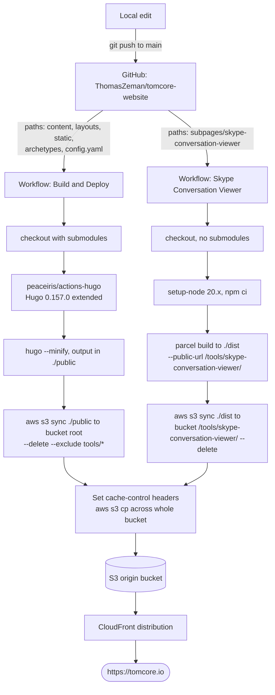

# Architecture — tomcore.io

How this repository is organized, how it is built, and how a `git push` ends up
serving <https://tomcore.io/> from Amazon CloudFront.

---

## 1. Overview

`tomcore-website` is the source for **tomcore.io**, a static personal site. There is no
runtime backend — everything is pre-rendered at build time in GitHub Actions and
uploaded to an S3 bucket that sits behind a CloudFront distribution.

The repository contains **two independent deliverables** that share one bucket and one
domain:

| Deliverable | Source | Built with | Lands at |
|---|---|---|---|
| The main documentation site | `content/`, `layouts/`, `static/`, `config.yaml` | Hugo (extended) + `hugo-book` theme | bucket root → `https://tomcore.io/` |
| Skype Conversation Viewer | `subpages/skype-conversation-viewer/` | Parcel + Preact + TypeScript | `tools/skype-conversation-viewer/` → `https://tomcore.io/tools/skype-conversation-viewer` |

Each has its own GitHub Actions workflow, triggered by path filters, so a content edit
never rebuilds the SPA and vice versa.

---

## 2. Repository layout

```
.
├── .github/workflows/
│   ├── main.yml                       # Hugo site: build → S3
│   └── skype-conversation-viewer.yml  # Preact SPA: build → S3
├── config.yaml                        # Hugo site config (single source of truth)
├── content/                           # Markdown content — this is the site
│   ├── _index.md                      # Home page (type: docs)
│   └── docs/
│       ├── articles/                  # Long-form write-ups (Raspberry Pi networking…)
│       └── howto/                     # Guides: cloud/, linux/{alpine,xfce}/, raspberrypi/
├── layouts/
│   └── partials/docs/inject/
│       └── content-after.html         # Theme hook: Support/License footer + clipboard.js
├── static/                            # Copied verbatim into the site root
│   ├── css/clipboard.css
│   ├── js/clipboard.js
│   ├── images/…                       # Screenshots & charts referenced by articles
│   └── mermaid.json                   # Mermaid runtime config
├── archetypes/default.md              # `hugo new` template
├── themes/hugo-book/                  # git submodule → alex-shpak/hugo-book
├── subpages/
│   └── skype-conversation-viewer/     # Standalone Preact app (own package.json)
├── public/                            # Hugo output — gitignored, build artifact
├── resources/                         # Hugo asset cache — gitignored
└── hugo.exe                           # Local Windows Hugo binary — gitignored
```

Git-ignored and therefore *not* part of the deployed source of truth: `public/`,
`resources/**`, `static/assets`, `hugo.exe`, `node_modules`, `dist`, `.parcel-cache`,
`.idea`, `push.bat`, `.hugo_build.lock`.

### The theme is a submodule

`.gitmodules` pins `themes/hugo-book` to <https://github.com/alex-shpak/hugo-book>.
The repo tracks a specific commit (`645c868`, described as `v10-39-g645c868`). CI must
therefore check out with `submodules: 'true'`, which `main.yml` does. Only
`content-after.html` overrides the theme locally; everything else comes from the
submodule.

---

## 3. Content model

Content is plain Markdown under `content/docs/`, rendered by the `hugo-book` theme.
Structure drives navigation:

- `BookSection: docs` in `config.yaml` makes `content/docs` the root of the sidebar menu.
- Directory nesting becomes menu nesting; `_index.md` files define section pages.
- Front matter is minimal — `weight` orders siblings, `title` names them,
  `bookFlatSection: true` flattens a section in the sidebar.
- `markup.goldmark.renderer.unsafe: true` allows raw HTML, which the mermaid/KaTeX
  shortcodes need.

Theme features enabled in `config.yaml`: `BookSearch` (client-side FlexSearch index built
at compile time), `BookToC`, `BookTheme: auto` (follows OS light/dark), `BookComments`,
`BookPortableLinks`, `BookServiceWorker` (emits `sw.js` for offline caching),
`enableGitInfo` (last-modified dates from git history), and `BookRepo`/`BookEditPath`
for "Edit this page" links back to GitHub.

`layouts/partials/docs/inject/content-after.html` is the one custom layout. It appends a
Ko-fi support blurb and a CC BY-SA license notice to every page whose content does not
match `Welcome to TomCore`, and conditionally pulls in `clipboard.js`/`clipboard.css`
only on pages that contain a `<pre>` block (copy-to-clipboard buttons for code samples).

Analytics: `googleAnalytics: G-82E23LZ4BK`. External sidebar links (LinkedIn, GitHub,
the nocap.gg projects, the Skype viewer, a Ko-fi widget) are declared under `menu.after`
in `config.yaml`.

---

## 4. Build & deploy pipeline



### 4.1 Hugo site — `.github/workflows/main.yml`

Triggers: `workflow_dispatch` (manual re-run from the Actions tab), or a push to `main`
touching `archetypes/**`, `content/**`, `layouts/**`, `static/**`, `themes/**`,
`.gitmodules`, `config.yaml`, or the workflow file itself. `themes/**` and `.gitmodules`
are in the list so that bumping the `hugo-book` submodule pointer redeploys on its own.

1. `actions/checkout@v4` with `submodules: 'true'` — required, or the theme is missing.
2. `peaceiris/actions-hugo@v2`, `hugo-version: 0.157.0`, `extended: true`.
   The extended build is needed for the theme's SCSS pipeline. The local `hugo.exe`
   in the working tree is the same version.
3. `hugo --minify` → writes `./public` (HTML, hashed CSS/JS bundles, the FlexSearch
   index, `sitemap.xml`, `index.xml`, `manifest.json`, `sw.js`, fonts, KaTeX, mermaid).
4. `aws-actions/configure-aws-credentials@v4` with static IAM user credentials from
   repository secrets, region `us-east-1`.
5. `aws s3 sync ./public/ s3://$AWS_BUCKET_NAME/ --delete --exclude "tools/*"`.
   The exclude is what keeps the two pipelines from stepping on each other — without it,
   `--delete` would wipe the separately-built SPA out of the bucket.
6. A cache-control pass (see §4.3).

### 4.2 Skype Conversation Viewer — `.github/workflows/skype-conversation-viewer.yml`

Triggers: `workflow_dispatch`, or a push to `main` touching
`subpages/skype-conversation-viewer/**` or the workflow file.

A standalone Preact 10 app in TypeScript (`app.tsx`, `conversation-list.tsx`,
`conversation-view.tsx`, `message-view.tsx`, `emoticon-viewer.tsx`, …), styled with
`goober`, bundled by **Parcel 2**. `package.json` aliases `react → preact/compat`, and
`tsconfig.json` uses the classic `h`/`Fragment` JSX factory. It is a pure client-side
bundle — no server component ships with it.

1. Checkout **without** submodules (the theme is irrelevant here).
2. `actions/setup-node@v4` Node 20.x, then `npm ci` (lockfile-exact install).
3. `npm run build` → `parcel build src/index.html --public-url /tools/skype-conversation-viewer/`.
   The `--public-url` is what makes the hashed asset paths resolve under the subdirectory
   rather than the domain root.
4. Same AWS credential configuration.
5. `aws s3 sync ./dist/ s3://$AWS_BUCKET_NAME/tools/skype-conversation-viewer/ --delete`
   — scoped to its own prefix, so `--delete` is safe here.
6. The same cache-control pass.

### 4.3 Cache-control strategy

The `sync` step tags everything it uploads with `max-age=86400, public` (24h) for the
Hugo site and `max-age=3600, public` (1h) for the SPA. A follow-up step then rewrites
headers per file type across the **entire bucket**:

| Pattern | Content-Type | Cache-Control |
|---|---|---|
| `*.html` | `text/html` | `max-age=60` |
| `*.css` | `text/css` | `max-age=31536000, public` (1 year) |
| `*.js` | `application/javascript` | `max-age=31536000, public` (1 year) |
| everything else | (as uploaded) | 24h / 1h from the sync step |

This is a standard hashed-asset strategy: Hugo and Parcel both emit content-hashed
filenames for CSS/JS, so those can be cached effectively forever; HTML is the mutable
entry point and gets a 60-second TTL. Because the rewrite runs bucket-wide
(`--recursive` from the bucket root), either workflow normalizes headers for *both*
deliverables.

### 4.4 Delivery: S3 → CloudFront → tomcore.io

`baseURL: https://tomcore.io/` in `config.yaml` is what Hugo bakes into absolute links,
canonical URLs, the sitemap, and the RSS feed.

The S3 bucket is the **origin**; a CloudFront distribution fronts it and serves the
`tomcore.io` domain over TLS. Deploys do **not** issue a CloudFront invalidation —
freshness is driven entirely by the `Cache-Control` headers above, so a content change
becomes visible once the edge's 60-second HTML TTL expires, while fingerprinted CSS/JS
never needs invalidating because a new build produces new filenames.

> **Not in this repository:** the CloudFront distribution, the S3 bucket policy / origin
> access config, the ACM certificate, and the DNS records are managed outside this repo
> (console or separate IaC). The only AWS coupling visible here is the three secrets and
> the `us-east-1` region.

### 4.5 Required GitHub secrets

| Secret | Used for |
|---|---|
| `AWS_ACCESS_KEY_ID` | IAM user for the deploy |
| `AWS_SECRET_ACCESS_KEY` | " |
| `AWS_BUCKET_NAME` | Target S3 bucket (held as a secret, so it is not named in this doc) |

The IAM principal needs, at minimum, `s3:ListBucket` on the bucket plus `s3:GetObject`,
`s3:PutObject`, and `s3:DeleteObject` on its contents (the `--metadata-directive REPLACE`
copies are server-side `PutObject` calls).

---

## 5. Local development

```bash
# One-time: the theme lives in a submodule
git submodule update --init --recursive

# Live-reload dev server on http://localhost:1313
hugo server

# Production-equivalent build into ./public
hugo --minify
```

Hugo must be the **extended** build; CI pins 0.157.0. A matching `hugo.exe` sits in the
repo root for Windows use and is git-ignored, so each machine supplies its own.

For the SPA:

```bash
cd subpages/skype-conversation-viewer
npm install
npm start          # parcel dev server, opens a browser
npm run build      # → ./dist, the same output CI ships
```

Nothing deploys from a developer machine; `main` is the only path to production.

---

## 6. Notes and sharp edges

- **Shallow checkout vs. `enableGitInfo`.** `actions/checkout@v4` defaults to
  `fetch-depth: 1`, so the git history available to Hugo in CI is a single commit. If the
  "last modified" dates on pages ever look wrong, set `fetch-depth: 0`.
- **The service worker adds a second cache layer.** `BookServiceWorker: true` ships
  `sw.js`, which caches visited pages in the browser independently of CloudFront TTLs.
  Returning visitors can therefore see stale pages longer than the 60-second HTML TTL
  suggests.
- **The header-rewrite step is O(bucket).** It re-copies every HTML/CSS/JS object in the
  bucket on every deploy, in both workflows. Fine at this size; it scales linearly.
- **Static long-lived AWS keys.** The deploy uses an IAM access key pair rather than
  GitHub OIDC role assumption — a rotation burden worth revisiting.
- **`--delete` safety depends on one flag.** If `--exclude "tools/*"` is ever dropped from
  `main.yml`, the next Hugo deploy silently deletes the Skype viewer from production.
